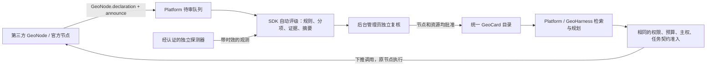

# GeoNode 声明、广播、评级与人工准入（SDK 增量方案）

本模块提供 Platform 可以复用的协议模型、确定性评级器、审核状态与准入工具。它不新增用户账号体系，不代替 RuoYi，不运行第三方代码，不搬运数据或模型权重，也不把评级当作人工批准。现有 MCP 适配器、GeoMCP 方法及 GeoCard Schema 保持兼容。

## 1. 统一路径与边界



只要通过相同的准入条件，第三方资源和官方资源具有相同的编排资格。评分、官方标签、发布者声称的 `trust.verified` 均不授予权限，也不决定调用路由。路由使用经审核的 node_id、节点地址、资源 ID 与内容摘要；不同节点可以有同名 GeoCard，目录 ID 会限定来源。

SDK 提供：模型、规则、可替换的参考治理服务（SQLite）、可选 FastAPI/HTTP 适配、CLI、原 GeoNode 的声明与广播方法。Platform 负责：真实身份认证、组织与租户、审批 UI、探测任务、生产数据库、访问权限、预算计量、执行与审计。GeoHarness 消费平台审核后的目录和版本，不另造一份审批权威。

本次实现没有修改或部署当前 Java Platform。下面 HTTP 路由是 SDK 参考治理协议，必须由 Platform 挂载或适配后才能用于真实后台；不能把 SDK Demo 的成功当作正式后台已完成接入。

## 2. 静态描述与治理信息分离

| 对象 | 内容 | 谁提供 |
|---|---|---|
| GeoCard | 数据、算子、模型、算力等静态语义、组成、输入输出含义 | 提供方 |
| NodeDeclaration | 节点 ID、负责人/机构声明、可达入口、协议、管辖域、声明算力 | 提供方 |
| ResourceDeclaration | 原始 GeoCard、版本、可见性、发布阶段、文档/源码/复现入口、标准执行绑定 | 提供方 |
| NodeAnnouncement | 节点与资源清单、递增 revision、发布时间、租约有效期 | 提供方广播 |
| Evidence | 针对具体摘要的观测结果、检查类型、认证探测器身份、时间和证据引用 | 平台认证探测器 |
| Rating | 规则版本和摘要、分项与依据、总分、等级、证据覆盖、阻断原因 | 平台运行 SDK 评级器 |
| review | 节点/资源分别审核、审核人、备注、批准/拒绝/撤销、对应清单摘要 | 后台审核人 |

广播仅发送元数据及契约，不发送账户密钥、数据文件或模型权重。源码可以不公开；是否公开源码会被记录，但闭源本身不意味着不可使用或不可信。`input_schema` 必须使用标准 JSON Schema，GeoCard 的逻辑数据类型不能直接当作 JSON Schema 的 `type`。

清单摘要绑定节点、资源、版本、可见性、执行工具、参数契约和发布说明。心跳仅续租而内容不变时摘要保持一致；任何声明内容改版都必须递增 revision，并使旧审批与旧观测不再适用于新版。本版采用保守策略：清单改版后节点与资源重新复核；审计历史不删除。

## 3. 评级模型：可解释的 readiness-v1，而非认证标准

默认分数仅是可配置的工程准备度基线，不声称是行业或科学认证等级。

资源的五项权重：

| 维度 | 权重 | 规则 |
|---|---:|---|
| 元数据与数据/算力完整度 | 25 | 描述、许可证、提供方、来源、版本；Data 再结合 CRS、范围、时间、访问、波段/输出和独立可访问性；Compute 再结合容量声明/探测 |
| 来源可信证据 | 20 | 来源引用只是声明，得 40；可信独立核验通过得 100；明确失败得 0 |
| 发布成熟度 | 15 | unknown=0、draft=0、experimental=35、stable=70、deprecated=0；文档与复现示例各加 15，上限 100 |
| 接口契约 | 25 | 标准工具输入/输出契约或声明数据入口=100；纯目录=25；非法执行 Schema=0 并阻断 |
| 可复现证据 | 15 | 只有认证探测器的独立重放结果才得分；示例网址不等于重放通过 |

未知证据按固定分母计零，不因缺少证据而重新归一化成高分。A≥85，B≥70，C≥50，其余 D；硬性阻断标为 not_ready。科学验收单独展示 pass/fail/unknown，已知独立检查失败进入阻断项。高分不证明科学结论正确，低分也不因来源是第三方而自动拒绝人工审核。

节点分项为声明完整度 20%、算力证据 25%、可达性 25%、资源契约完整比例 30%。另给出 `unknown / small_cpu / standard_cpu / large_cpu / accelerated` 容量类别；默认 standard 为至少 8 核/16 GiB，large 为至少 32 核/64 GiB，可按策略调整。容量类别与信任等级不同，GPU 缺失不扣可信分；声明容量、经探测核验的声明和实时空闲容量分别表达，实时空闲量缺省为 unknown。

证据覆盖率表示适用的独立检查中有多少得到当前有效的结果，失败也算“已测量”；它不是“正确概率”。证据必须匹配节点/资源摘要，来自允许的探测器，并处于有效期。节点自己上传一个 `issuer` 字符串不构成认证；服务要求该字符串与宿主验证的探测器身份一致。原始证据的真实性、探测过程和签名验证由 Platform 负责，SDK 不根据网址存在就认定核验成功。

## 4. 审核与编排规则

- 提交固定进入 pending，发布者不能审核自己的节点或资源；即使其角色还拥有审核权限也不行。
- 节点批准不等于所有资源自动批准，必须明确选择并审核资源。
- 标准契约不兼容的资源保留诊断信息，不能靠高分或管理员直接绕过接口修复。
- 已批准但过期、撤销、改版的资源不能沿用旧准入结果。被撤销的必需组成项也不能借一个公开父 GeoCard 重新出现。
- 公共目录仅输出节点与资源都批准、有效、且通过 GeoCard 组成可见性检查的条目；private/restricted/secret 不会因批准而自动公开。
- `eligible()` 对官方与第三方走同一套判断：当前摘要、双层批准、声明有效期、当前可信可达性、标准可调用/可访问绑定，以及宿主提供的访问权限、本次授权、预算、主权、任务契约五项决定。unknown 不等于允许。
- 审核后可检索、可规划，不代表可以任意提交计算。纯模型方法说明、算力说明或工作流故事仍可能只有目录能力；需有对应工具/适配器/配方，才能成为执行步骤。
- 数据访问地址不等于实际影像/栅格。必须继续使用 `geonexus.geocard.contracts` 的任务契约检查与结果验收；影像足迹不能代替影像，结构通过不能代替科学验收。

`Principal` 和 `AccessContext` 都必须在服务器内由已验证的认证与策略服务生成，不能直接从客户端请求体接受。HTTP 适配器刻意不暴露“用户上传五个 true 就可执行”的接口。SDK 准入判断不分发作业，实际执行前宿主仍需重新核验当前版本/撤销状态，节点也需验证调用身份与授权。

## 5. 提供方使用

```python
from geonexus.admission import Capacity, NodeDeclaration, Publication

# node 是已经登记真实 GeoCard 与对应 GeoSkill 的 GeoNode。
# 具有 geocard 的 Skill 也必须把该卡登记进 node.geocard_registry，确保可实际解析。
announcement = node.declaration(
    NodeDeclaration(node_id="my-institute", name="机构节点", operator="机构名称",
                    endpoint="https://node.example.org", jurisdictions=["CN"],
                    capacity=Capacity(cpu_cores=8, memory_gib=16, gpu_count=0)),
    version="1.0.0", revision=1, visibility="public",
    publication=Publication(stage="stable", documentation="https://example.org/docs"),
)
# api_key 从安全环境/凭据服务读取；只发给固定的治理服务，不写入清单。
receipt = node.announce("https://platform.example.org", announcement, api_key=registry_key)
# receipt 是待审回执，不是上线许可。
```

默认声明可见性为 restricted，未填写的发布成熟度为 unknown。示例中的 public 是提供方明确声明；GeoCard 自身或必需组成项更严格时仍按更严格的可见性执行。节点容量是声明值，默认不会被当作实测值。心跳重发同一内容、相同 revision 的清单，仅更新 declared_at/expires_at；平台/节点自己的调度器控制周期，SDK 不静默启动后台广播线程或扫描局域网。

旧 `GeoNode.advertise()` 保持兼容，用于原 Registry；它不会自动获得本模块治理批准。生产 Platform 不应把旧注册接口的默认 approved 与新治理审核结果混为同一授权来源。

## 6. Platform 接入契约

可选 `create_admission_app(service, authenticate)` 提供：

| HTTP | 权限/用途 |
|---|---|
| POST /api/v1/node-announcements | nodes:submit，声明/续租，待审回执和自动评级 |
| GET /api/v1/node-announcements | nodes:review，后台待审/状态队列 |
| GET /api/v1/nodes/{id}/declaration | nodes:review，待审的准确原始清单与摘要 |
| GET /api/v1/nodes/{id}/reviews | nodes:review，追加式审核历史 |
| GET /api/v1/nodes/{id}/assessment | nodes:review，分项和证据状态 |
| POST /api/v1/nodes/{id}/observations | observations:write，且必须是策略允许的独立探测身份 |
| POST /api/v1/nodes/{id}/reviews | nodes:review，正文没有审核人或权限字段 |
| GET /api/v1/admitted-resources | 仅人工准入的公开资源视图，保留源节点、摘要、绑定与评级摘要 |

生产接入顺序：

1. 在 RuoYi/BFF 验证 token、账号、机构与 scopes，将认证结果映射为 Principal；不能直接使用示例身份头。
2. 后台节点登记采用 NodeAnnouncement，保留原始快照和审核主体；复用评级函数，展示“声明/独立核验/未知”。
3. 独立探测任务核验节点地址、源数据访问、算力、来源和复现，平台负责 SSRF/租户边界、调用预算、证据签名与存储；不要自动访问任意上传 URL。
4. 后台分别批准节点与资源，将同一批准视图供 Platform 与 GeoHarness 使用；现有官方资源也接入相同视图，不按提供方类别分叉编排逻辑。
5. 每次派发在 Java 执行路径重新检查权限、主权、预算与任务契约，并按 node_ref 下推；关联 request_id、资源摘要、执行记录和结果验收。

参考 AdmissionService 使用标准库 SQLite 持久化声明、观测、评级快照与审核历史，便于测试与轻量部署；生产 Platform 可复用纯模型/评级函数并映射到既有 PostgreSQL，SDK 不要求另建账户数据库。当前参考实现的 composition 解析仅覆盖同一已审清单，跨节点组成必须由平台目录解析后再判定；缺少必需组成项时保守隐藏/拒绝。

## 7. 可执行 Demo 与工具

在安装了 SDK server/http 可选依赖的环境中运行：

```sh
python examples/governed_node_demo.py --output /tmp/geonexus-admission-demo
python -m geonexus.admission rate /tmp/geonexus-admission-demo/announcement.json
python -m geonexus.admission schemas --output /tmp/geonexus-admission-schemas
# 可安装入口名为 geonode-admission；提交密钥仅通过指定环境变量读取。
geonode-admission submit announcement.json --registry https://platform.example.org
```

可用 `python examples/rate_node_snapshot.py geo-describe.json --output ratings.json` 离线评估已有节点快照；快照版本使用内容摘要，不假定上游发布版本，发布成熟度与独立证据保持 unknown。当前 Durham 的输入和输出契约均会检查，因此比只检查输入更严格。

Demo 在本机临时端口启动真实 GeoNode，使用进程内 HTTP 治理服务模拟 Platform，覆盖：广播→自动评级→独立人工复核→实际回环健康检查→统一目录→准入检查→GeoMCP 要素计数→撤销拒绝。四类卡片为 Data/Skill/Model/Compute；数据为明确标记的合成 GeoJSON，仅验证工程链路，不声称完成真实区域研究、算力基准或科学验证。输出 announcement.json、demo-report.json 和参考治理数据库；不要把 Demo 身份句柄用于生产。
